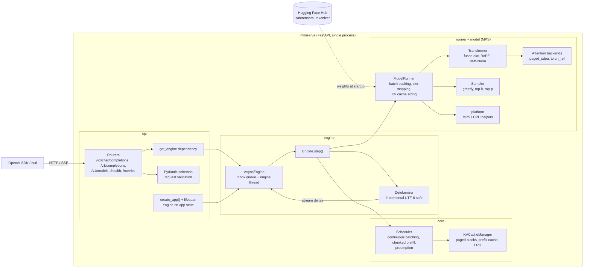
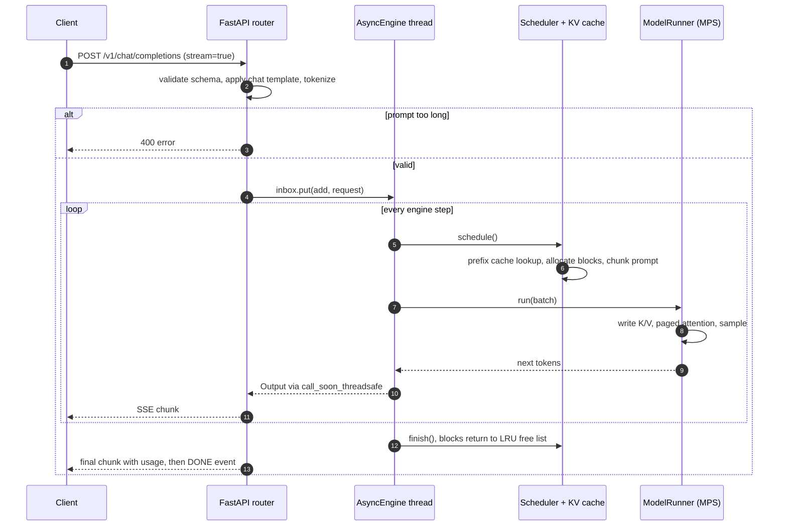
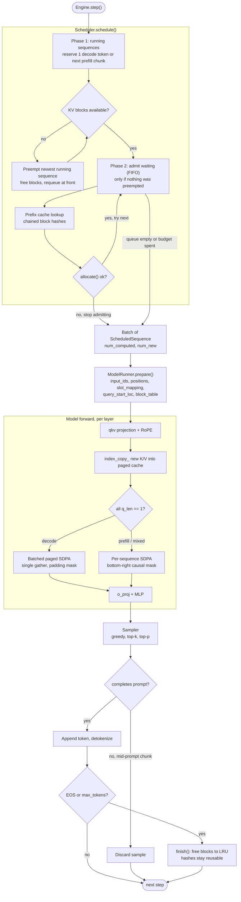
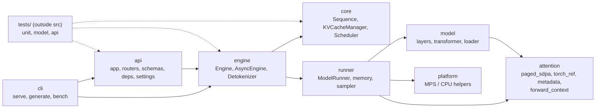

## miniserve 

A tiny vLLM implementation, to serve models at scale.
This uses a simplified implementation of 
- Paged KV Cached with prefix caching
- Continuous batching with chunked prefill, 
- SDPA(Flash Attention is CUDA dependent) , 
- static shapes + preallocation + Metal fusion , 
- and using FastAPI to setup a OpenAI-compatible HTTP Server.(to query and setup the whole flow of chatting with a LLM).

### Architecture

### Streaming Request LifeCycle

### Engine

### Packages

### References

- [Paged Attention](https://arxiv.org/abs/2309.06180)
- [Prefix Caching](https://docs.vllm.ai/en/stable/design/prefix_caching/)
- [vLLM Scheduler High Level Sketch](https://audreywongkg.medium.com/understanding-vllm-scheduling-token-budgets-chunked-prefill-and-policies-2c879e3980e3)
- [Continuous Batching](https://huggingface.co/blog/continuous_batching)
- [Chunked Prefill](https://medium.com/@shirleyzhai521/how-chunked-prefill-improves-llm-serving-in-vllm-b3705dea557f)
- [SDPA](https://docs.pytorch.org/docs/2.14/generated/torch.nn.functional.scaled_dot_product_attention.html)

### Future Work
- [Speculative Decoding](https://research.google/blog/looking-back-at-speculative-decoding/)
- [Implementing Speculative Decoding in PyTorch](https://github.com/romsto/Speculative-Decoding)
