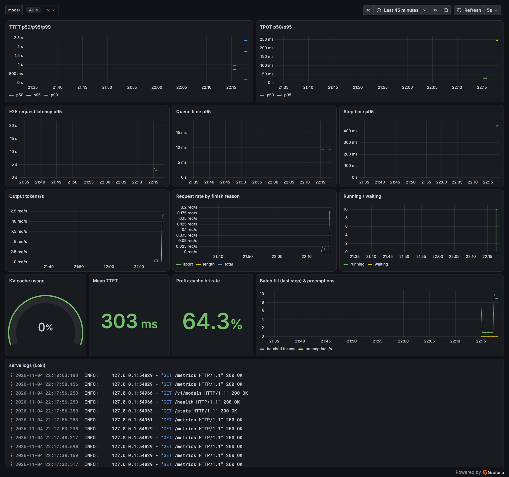
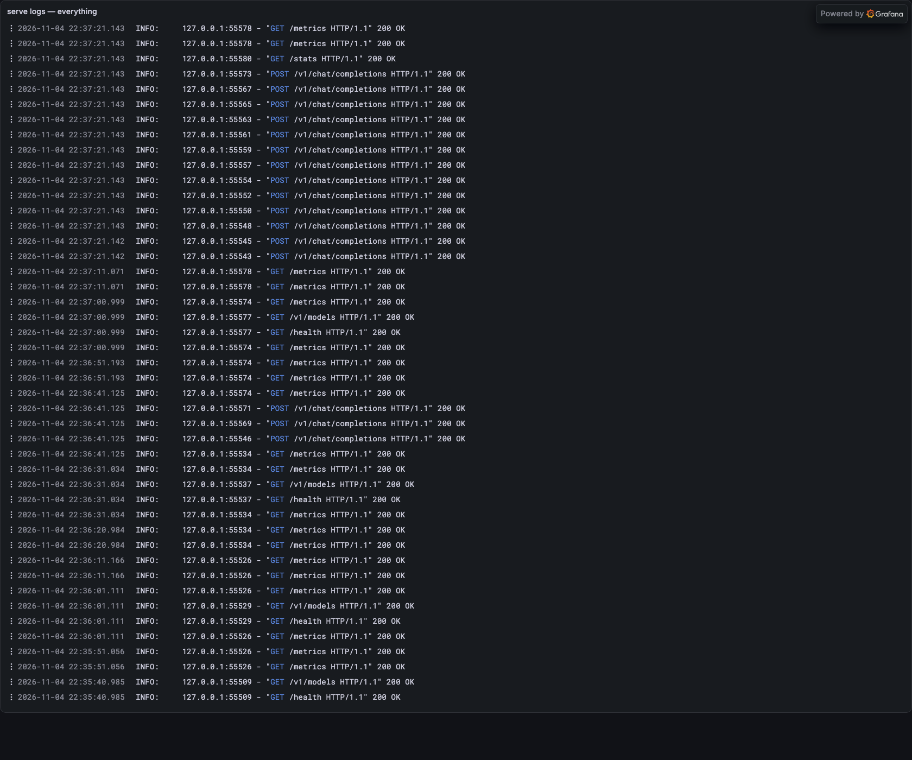
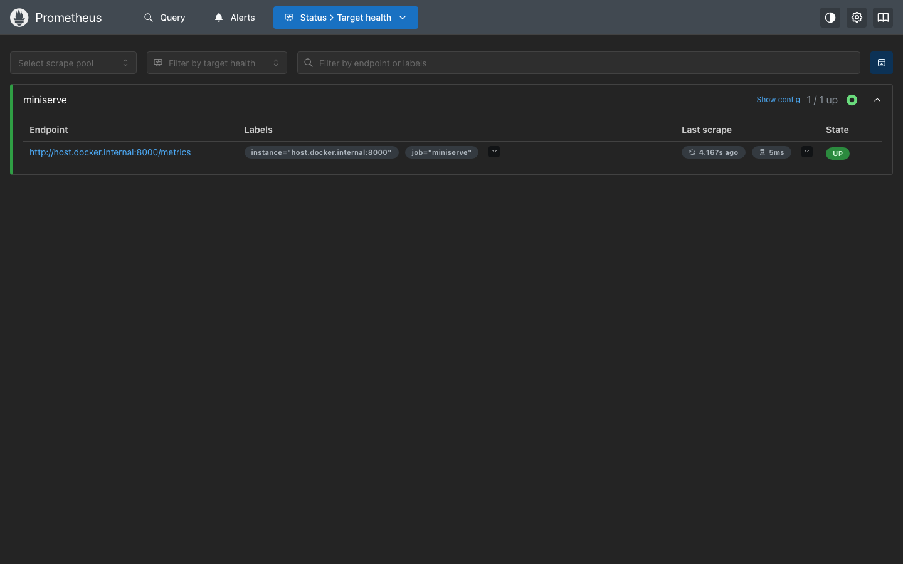
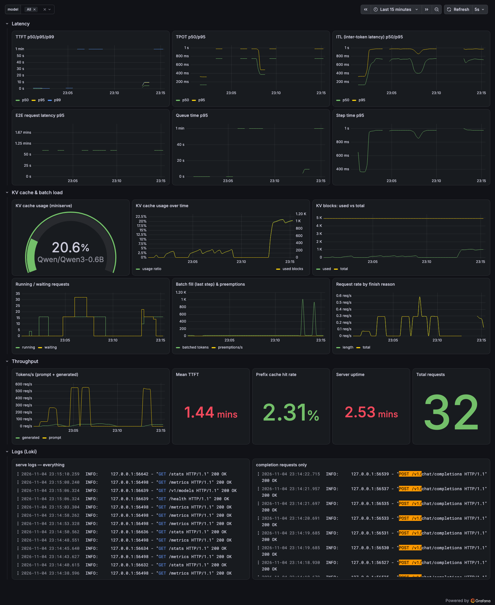
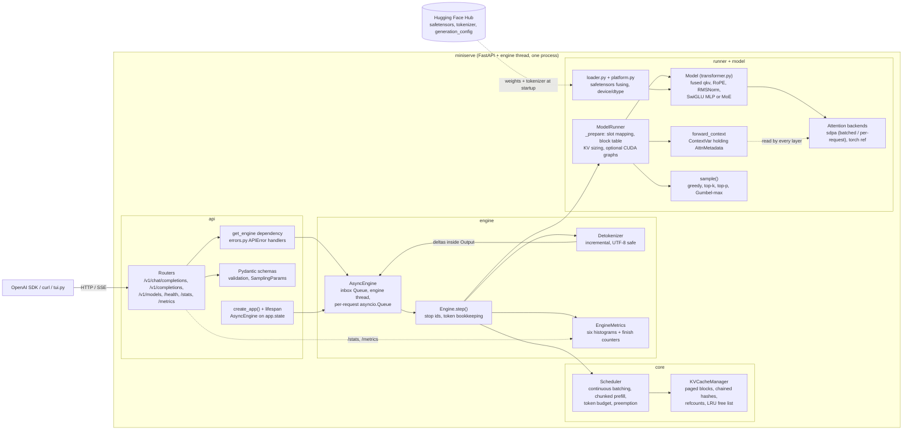
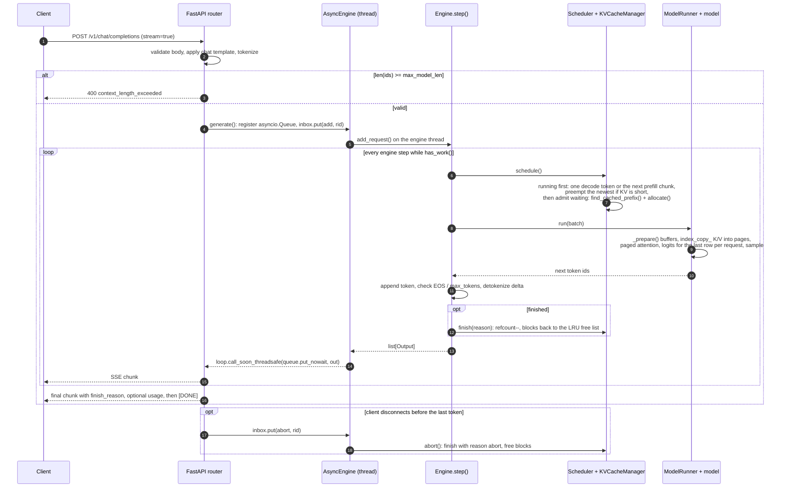
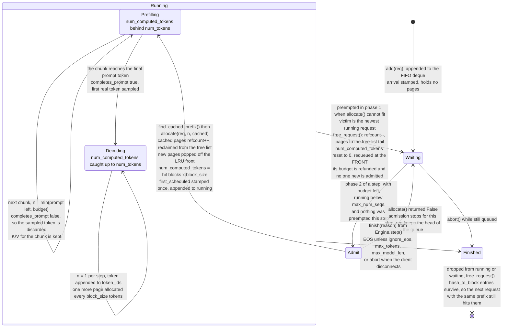

## miniserve 

A mini vLLM implementation trying to learn how vLLM serves models at scale.
Main things that I implement in this are:
- Paged KV Cached with prefix caching
- Continuous batching with chunked prefill 
- SDPA(Flash Attention is CUDA dependent)


### Commands

Everything runs through one CLI: `uv run main.py <command>` from the repository
root. The repository is used without installing `miniserve` itself — `uv sync`
only installs third-party dependencies, and tests/demos import the code straight
out of the tree.

```bash
uv venv                  # create the virtual env
uv sync                  # install dependencies
uv run main.py --help    # serve | generate | bench | attn-demo | kv-demo
```

`serve`, `generate` and `bench` share the engine flags:

| flag | default | what it does |
| --- | --- | --- |
| `--model` | `Qwen/Qwen3-0.6B` | HF model id or a local checkpoint directory (`MINISERVE_MODEL`) |
| `--device` | `auto` | `auto` picks mps, then cuda, then cpu |
| `--dtype` | `auto` | fp16 on mps, bf16 on cuda, fp32 on cpu |
| `--max-model-len` | `4096` | longest prompt + output, in tokens |
| `--max-num-seqs` | `16` | requests the scheduler keeps running at once |
| `--max-num-batched-tokens` | `1024` | per-step token budget that drives chunked prefill |
| `--gpu-memory-utilization` | `0.60` | share of device memory the KV cache may take |
| `--attention-backend` | `auto` | `sdpa`, `torch` (reference), or `flash_attn` (falls back to sdpa) |
| `--block-size` | `16` | tokens per KV page |
| `--prefix-caching / --no-prefix-caching` | on | reuse pages across requests sharing a prefix |
| `--cuda-graphs / --no-cuda-graphs` | off | CUDA only, ignored elsewhere |

**serve** — OpenAI-compatible HTTP server:

```bash
uv run main.py serve --model Qwen/Qwen3-0.6B --port 8000
```

```bash
curl localhost:8000/v1/chat/completions -H 'content-type: application/json' -d '{
  "model": "Qwen/Qwen3-0.6B",
  "messages": [{"role": "user", "content": "explain paged attention"}],
  "max_tokens": 128,
  "stream": true
}'
```

`/v1/completions`, `/v1/models`, `/health` and `/stats` are served too;
`/metrics` exposes the same counters to Prometheus (see `docs/MONITORING.md`).

**generate** — one prompt, no server:

```bash
uv run main.py generate -p "explain paged attention" --chat --max-tokens 128
uv run main.py generate -p "2 + 2 =" --temperature 0.7 --top-p 0.9 --no-stream
```

### Chat UI

`tui.py` is a terminal chat client, kept out of the package on purpose: it is a
separate process that only speaks HTTP to a server, so the server keeps the
model, the KV cache and the device to itself. It streams
`/v1/chat/completions` with `stream=true` and shows tokens/s, time to first
token and how much of each prompt the prefix cache served.

```bash
uv run main.py serve --model Qwen/Qwen3-0.6B   # one terminal
uv run tui.py                                  # another terminal

# or let the ui own the server and stop it again on exit
uv run tui.py --spawn --model HuggingFaceTB/SmolLM2-135M-Instruct
uv run tui.py --spawn --serve-args='--device cpu --max-num-seqs 4'
uv run tui.py --base-url http://127.0.0.1:8000 --max-tokens 256 --temperature 0.2
```

With `--spawn` the server runs as a child process, its log goes to
`$TMPDIR/miniserve-serve-<pid>.log`, and the ui waits on `/health` while the
weights load. Keys: enter sends, escape stops the running generation, ctrl+r
starts a fresh conversation, ctrl+c quits. The client needs `textual` and
`httpx`, both in the dev group, so `uv sync` is enough.

### Benchmarks

`bench` runs the same prompt set three ways and prints one table: miniserve with
prefix caching, miniserve without it, and optionally Hugging Face `generate` as a
static-batching baseline. Each arm loads its own engine, does a throwaway warm-up
request so lazy kernel compilation is not timed, then measures from the moment
requests are submitted.

```bash
# default: 16 prompts, 64 new tokens each, both miniserve arms
uv run main.py bench

# add the Hugging Face baseline, and push the engine harder
uv run main.py bench --hf-baseline --num-prompts 64 --max-tokens 128

# small and quick, useful while changing the scheduler
uv run main.py bench --model HuggingFaceTB/SmolLM2-135M-Instruct \
  --num-prompts 8 --max-tokens 16 --max-num-seqs 4 --max-num-batched-tokens 512

# isolate a backend or the paged-cache path
uv run main.py bench --attention-backend torch --device cpu
```

| column | meaning |
| --- | --- |
| `req/s` | finished requests per second of wall clock |
| `out tok/s` | generated tokens per second |
| `tot tok/s` | prompt + generated tokens per second |
| `p50 ttft` | median time to first token (`-` for the HF baseline, which gives no per-token timing) |
| `p50 / p90 lat` | end-to-end latency per request, measured from submission |
| `cached` | share of prompt tokens served from the prefix cache |

The prompt set lives in `miniserve/benchmarks/prompts.py`: a deterministic mix
of short and long instructions behind a shared system prompt, rendered through the
model's chat template, so prefix caching has something real to hit. The baseline
also reports `padded_prompt_tokens` in its result dict, which is the padding waste
static batching pays and continuous batching does not.

```bash
uv run main.py attn-demo    # compare paged attention backends on a toy pool
uv run main.py kv-demo      # step through the KV cache manager by hand
uv run pytest               # test suite
```

### Sample Run

Everything below is a real run on an M-series Mac (MPS): the server
serving `Qwen/Qwen3-0.6B`, two traffic bursts, and the monitoring stack
grinding through it. Full artifacts (raw SSE, JSON bodies, log, JSONL timings,
screenshots) live in `output/`.

```bash
# terminal 1: the server itself (needs MPS, so it runs natively)
uv run main.py serve --model Qwen/Qwen3-0.6B --host 0.0.0.0 --port 8000

# terminal 2: prometheus + grafana + loki + promtail in docker
# (see docs/MONITORING.md; prometheus.yml points at host.docker.internal:8000)
docker compose -f deploy/docker-compose.yml up -d

# stop everything when done
#   server: Ctrl+C (or `lsof -ti :8000 | xargs kill`)
#   dashboard stack: stops the containers, but keeps their disk
docker compose -f deploy/docker-compose.yml down
colima stop            # only if you run docker through colima, not Docker Desktop
```

Server log from that run (`output/miniserve-serve.log`):

```text
[miniserve] serving Qwen/Qwen3-0.6B on http://0.0.0.0:8000 (mps, sdpa)
INFO:     Uvicorn running on http://0.0.0.0:8000 (Press CTRL+C to quit)
[miniserve] KV Cache: 4097 blocks x 16 tokens = 65552 tokens (7.0 GB)
INFO:     127.0.0.1:54829 - "GET /metrics HTTP/1.1" 200 OK
```

Input/output pair, captured via curl (`output/input-chat-completions.json` →
`output/output-chat-completions.json`):

```json
// input
{"model": "Qwen/Qwen3-0.6B",
 "messages": [{"role": "user",
               "content": "Explain page tables and paged attention in five sentences for a systems programmer."}],
 "max_tokens": 200, "temperature": 0.7}
```

```jsonc
// output (excerpt) — Qwen3-0.6B runs in thinking mode here, the plan text is its own
{"id":"chatcmpl-23b0e48c65da4664a0e88e8aec44b921","object":"chat.completion",
 "model":"Qwen/Qwen3-0.6B",
 "choices":[{"index":0,"message":{"role":"assistant",
   "content":"\nOkay, the user wants me to explain page tables and paged attention..."},
   "finish_reason":"length"}],
 "usage":{"prompt_tokens":24,"completion_tokens":200,"total_tokens":224,
          "prompt_tokens_details":{"cached_tokens":0}}}
```

Streaming/SSE capture with the request on top:
`output/input-and-output-chat-stream.sse`.

Load was driven with `demos/load_client.py`, which fires 24 requests at
Poisson arrivals (mean gap 350ms) and records per-request client timings to
`output/load-run.jsonl` — client-side numbers include network + SSE framing, so
they sit above the server-side histograms on purpose:

```text
requests=24 wall=23s  out_tok=1920  out_tok/s=83.6
client ttft p50/p95: 22.5s / 22.6s      # saturated burst: everyone queues
client e2e  p50/p95: 22.8s / 44.0s

# second, gentler burst (10 requests, 1s gap, 64 tokens)
requests=10 wall=11.7s out_tok=512  out_tok/s=43.9
client ttft p50/p95: 0.5s  / 0.5s       # idle server: prompt heads are cached
client e2e  p50/p95: 11.0s / 11.3s

# third burst for the KV panels (16 requests, 0.6s gap, 128 tokens)
requests=16 wall=36.0s out_tok=1664 out_tok/s=46.2
client ttft p50/p95: 1.3s  / 2.0s
client e2e  p50/p95: 36.0s / 36.2s
# KV peak during this burst: ~110 used blocks of 4096 (2.7%)
```

`GET /metrics` (rendered by hand in `miniserve/api/routers/metrics.py`, no
prometheus_client) now exports six latency histograms on top of the counters,
and the finished counter carries a `reason` label. Snapshot in
`output/output-metrics.txt`:

```text
miniserve_requests_finished_total{model_name="Qwen/Qwen3-0.6B",reason="abort"} 1
miniserve_requests_finished_total{model_name="Qwen/Qwen3-0.6B",reason="length"} 38
miniserve_time_to_first_token_seconds_count{model_name="Qwen/Qwen3-0.6B"} 39
miniserve_inter_token_latency_seconds_count{model_name="Qwen/Qwen3-0.6B"} 3392
miniserve_step_duration_seconds_count{model_name="Qwen/Qwen3-0.6B"} 745
```

Checked end-to-end per `docs/MONITORING.md` §7: `promtool check config` passes,
the `miniserve` target is UP at `localhost:9090/targets`, and the percentile
incantation returns real numbers, not `NaN`:

```promql
histogram_quantile(0.95, sum by (le) (rate(miniserve_time_to_first_token_seconds_bucket[1m])))
# -> 1.75s during the saturated burst; mean TTFT 303ms, prefix cache hit 64.3%
```

Grafana dashboard (`deploy/grafana/dashboards/miniserve.json`) — three
sections: **Latency** (TTFT p50/p95/p99, TPOT, ITL, E2E, queue, step time,
mean-TTFT stat), **KV cache & batch load** (usage gauge labeled with the
serving model, usage-over-time with used blocks on a right axis, used-vs-total
blocks, running/waiting, batch fill + preemptions, finish-reason split), and
**Throughput + Logs** (tokens/s, prefix-cache hit, uptime, request count, plus
two Loki panels: all serve logs and `POST /v1/` completion requests only):



Serve logs reach Grafana through promtail → Loki (client disconnects show up as
`reason="abort"` in the metrics and as access-log lines in the panel):



Prometheus target page — `miniserve` is scraped every 5s through
`host.docker.internal`; a DOWN here almost always means the server was bound to
`127.0.0.1` instead of `0.0.0.0`:



### Experiments

**Long-context load — 32 requests, ~4.6 KB prompts each, `--max-model-len 8192`.**
The demo burst above peaked the KV panels at 2.7%, which proves the plumbing but
not the scheduler. This run gives it real work: 32 requests arriving Poisson
(0.3s mean gap), prompts grown to ~970 tokens each, 128 output tokens, server at
`--max-model-len 8192` (KV pool 4940 blocks):

```bash
uv run main.py serve --model Qwen/Qwen3-0.6B --host 0.0.0.0 --port 8000 --max-model-len 8192

LOAD_REQUESTS=32 LOAD_GAP=0.3 LOAD_PROMPT_CHARS=4600 LOAD_MAX_TOKENS=128 \
LOAD_TIMEOUT=300 LOAD_OUT=output/load-run-long.jsonl .venv/bin/python demos/load_client.py
```

Two lessons came out of the first two attempts, both worth keeping:

1. **A 120s client timeout kills 32-request bursts.** The engine admits 16
   sequences at a time and runs each wave to lock-step completion, so with equal
   prompt lengths the clients see two waves: wave 1 finishes ~79–89s, wave 2
   ~154–158s after arrival. Half the first-attempt requests died with
   `httpx.ReadTimeout` at exactly 120s while the engine happily finished all 32
   — server logs showed 32 × `200 OK` only because uvicorn logs when the
   response *starts*. Fix: the client timeout is now `LOAD_TIMEOUT` (default
   300s), sized for multi-wave MPS decode.
2. **Shared prompt bodies fake the KV story.** The first long-prompt generator
   repeated one document body, so 28,272 of 30,384 prompt tokens (93%) came from
   the prefix cache, KV peaked at 4.7%, and the run measured the cache, not the
   pool. `build_prompt` now interleaves a unique `SLOTiii` tag every ~800-char
   chunk so no two requests share a block: cache hit drops to **4.8%** (only the
   ~48-token chat template), and prefill becomes real compute.

What the clean run looks like (32/32 finished, reason `length`, 0 preemptions):

```text
requests=32 wall=157.88s out_tok=4096 out_tok/s=25.9
client e2e: wave 1 78.6–88.8s (16 reqs) · wave 2 154.3–158.2s (16 reqs)
server: 31,133 prompt tok (mean 972/req) · 4,096 gen · 271 steps · cached 1,488 (4.8%)
KV peak ~20.6–21.4% (~1,057/4,939 blocks): 16 admitted × ~1,050 tok/wave —
        the other 16 wait (scheduler slot cap, not KV pressure) and hold no blocks
ITL p95 ~1s mid-run vs ~470ms in the short-prompt burst (longer context = pricier attention)
```



Gauge at 20.6% under the model label with wave 2 still running; watch the
running/waiting panel show the two waves and the usage-over-time plateau.
Artifacts: `output/load-run-long.jsonl` (per-request e2e + usage incl.
`cached_tokens`), `output/long-run-summary.txt`, `output/stats-long-run.json`,
`output/metrics-long-run.txt`.

### Architecture


### Streaming Request LifeCycle



### Scheduler

The flowchart under [Engine](#engine) shows one call to `schedule()`. This is the
other half: where a single request sits across many calls, and what happens to
its pages at each move. `num_computed_tokens` is the whole state — how many of
its tokens already have K/V in the pool — and the only transition that throws
work away is preemption.



Two details the diagram encodes that are easy to miss in the code:

- A preempted request goes to the **front** of the queue, not the back, and its
  `num_computed_tokens` goes to zero — it re-prefills. That is usually cheap,
  because `free_request()` only drops refcounts and the pages keep their hashes,
  so `find_cached_prefix()` normally hands most of the prompt straight back.
  `num_cached_tokens` is kept as a `max()` for that reason.
- A request that cannot fit even when it is the only one running preempts
  *itself*, is skipped for the step, and is retried from the queue. That is the
  one case where preemption does not make room for anybody.

### Engine

```mermaid
flowchart TB
    start(["Engine.step()"]) --> p1

    subgraph schedule["Scheduler.schedule(), budget = max_num_batched_tokens"]
        p1["Phase 1: running requests, in order<br/>n = min(tokens not yet computed, budget)<br/>1 while decoding, a chunk while prefilling"]
        fit1{"kv.allocate(req, n)?"}
        pre["Preempt the newest running request<br/>free its blocks, reset num_computed_tokens,<br/>requeue at the front, refund its budget"]
        victim{"was the victim req itself?"}
        more{"more running, budget left?"}
        p2["Phase 2: admit waiting (FIFO)<br/>only if nothing was preempted, and<br/>budget > 0 and running < max_num_seqs"]
        hit["kv.find_cached_prefix()<br/>chained block hashes, whole blocks,<br/>always leaves >= 1 token to compute"]
        fit2{"kv.allocate(req, n, cached)?"}

        p1 --> fit1
        fit1 -->|"no"| pre --> victim
        victim -->|"no, retry req"| fit1
        fit1 -->|"yes"| more
        victim -->|"yes, it outgrew the cache"| more
        more -->|"yes"| p1
        more -->|"no"| p2
        p2 --> hit --> fit2
        fit2 -->|"yes: admit, try the next one"| p2
    end

    fit2 -->|"no: stop admitting"| batch
    p2 -->|"queue empty, budget spent, or at max_num_seqs"| batch

    batch["list[ScheduledRequest]<br/>num_computed, num_new<br/>num_computed_tokens advanced optimistically"] --> prep
    prep["ModelRunner._prepare()<br/>input_ids, positions, slot_mapping,<br/>query_start_loc, cu_seqlens_k, block_table<br/>-> AttnMetadata bound in the forward context"] --> cg
    cg{"every num_new == 1<br/>and decode graphs captured?"}
    cg -->|"yes (CUDA only)"| replay["graph.replay() over the persistent buffers"]
    cg -->|"no"| fwd

    subgraph forward["Model forward, per decoder layer"]
        fwd["fused qkv projection, optional q/k norm, RoPE"] --> write["index_copy_ the new K/V into the paged pool<br/>slot = block_id * block_size + offset"]
        write --> kind{"all query lengths equal?"}
        kind -->|"yes"| dec["Batched SDPA<br/>gather + pad each request's pages,<br/>pure decode with equal kv_len runs maskless"]
        kind -->|"no, mixed prefill/decode"| pf["Per-request SDPA<br/>bottom-right causal mask"]
        dec --> mlp["o_proj + SwiGLU MLP (or MoE)"]
        pf --> mlp
    end

    replay --> head
    mlp --> head
    head["logits: last packed row of each request<br/>through the tied embedding or lm_head"] --> samp["sample()<br/>greedy, or temperature + top-k/top-p + Gumbel-max"]
    samp --> done{"completes_prompt?"}
    done -->|"no, mid-prompt chunk"| drop["Discard the sample<br/>its K/V is already in the cache"]
    done -->|"yes"| commit["Append token, observe TTFT / ITL, detokenize delta"]
    commit --> stop{"EOS (unless ignore_eos),<br/>max_tokens, or max_model_len?"}
    stop -->|"yes"| fin["finish(reason): refcount--,<br/>blocks to the LRU free list,<br/>their hashes stay reusable until the page is taken"]
    stop -->|"no"| nextstep(["next step"])
    drop --> nextstep
    fin --> nextstep
```



### References

- [Paged Attention](https://arxiv.org/abs/2309.06180)
- [Prefix Caching](https://docs.vllm.ai/en/stable/design/prefix_caching/)
- [vLLM Scheduler High Level Sketch](https://audreywongkg.medium.com/understanding-vllm-scheduling-token-budgets-chunked-prefill-and-policies-2c879e3980e3)
- [Continuous Batching](https://huggingface.co/blog/continuous_batching)
- [Chunked Prefill](https://medium.com/@shirleyzhai521/how-chunked-prefill-improves-llm-serving-in-vllm-b3705dea557f)
- [SDPA](https://docs.pytorch.org/docs/2.14/generated/torch.nn.functional.scaled_dot_product_attention.html)

### Future Work
- [Speculative Decoding](https://research.google/blog/looking-back-at-speculative-decoding/)
- [Implementing Speculative Decoding in PyTorch](https://github.com/romsto/Speculative-Decoding)
