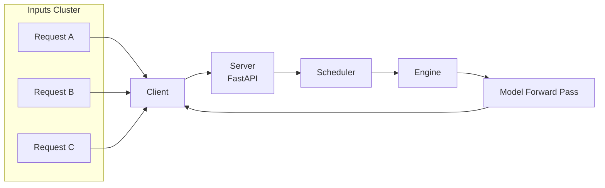
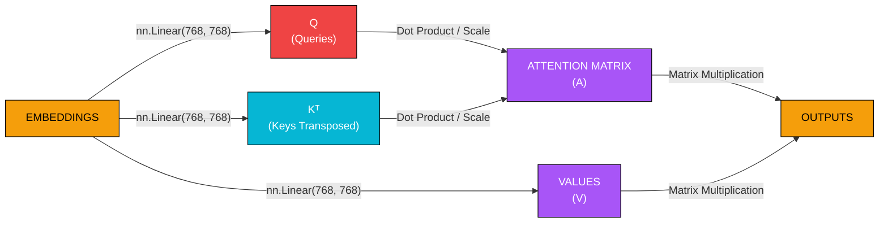

- llm serving requires to build software to serve the LLM to most users and techniques like paged attention and continuous batching help us regarding that.

- Scheduler:
    - gets lots of requests 
    - where do these requests go 

- Engine:
    - how does it move the things forward 

- Model Forward Pass:
    - how to compute the things and maintain KV Cache for this 

- MLP is the easy part, at each time step, gets the same exact matrix multiplication 
$Q(GELU(W(x)))$

- attention in one picture

